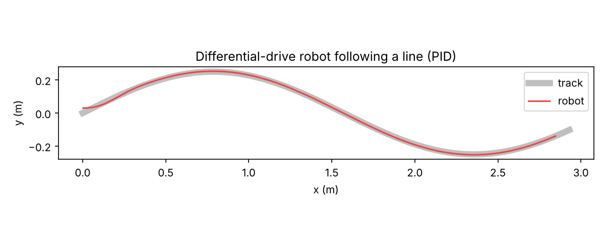

# diffbot — Line-Following Robot in C++

Control code for a **differential-drive line-following robot**: a PID controller,
wheel odometry and an IR line-sensor estimator, written as small header-only
C++ classes. The **same code** runs on an Arduino/ESP32 and in a desktop
simulator, so you can tune the controller before touching hardware.




## What's inside

| File | What it does |
|------|--------------|
| `include/diffbot/pid.hpp` | PID with anti-windup, derivative-on-measurement, output clamping |
| `include/diffbot/odometry.hpp` | Diff-drive kinematics + exact-arc encoder odometry |
| `include/diffbot/line_sensor.hpp` | Weighted line position from an N-sensor IR array, remembers last side when lost |
| `sim/simulate.cpp` | Physics + noisy sensor simulation on a curved track |
| `tests/test_main.cpp` | Unit tests (no external dependencies) |
| `firmware/line_follower/` | Arduino sketch with auto-calibration |

Simulator result with default gains: **~3.5 mm RMS tracking error**, line never lost.

## Build & run

```bash
cmake -S . -B build && cmake --build build
./build/diffbot_tests                 # unit tests
./build/diffbot_sim > run.csv         # simulate 12 s of driving
python sim/plot.py run.csv            # plot path vs track
ctest --test-dir build                # tests + simulator pass/fail check
```

## Hardware

- Arduino Uno/Nano or ESP32
- 8-channel IR reflectance array (QTR-8A or TCRT5000 board)
- TB6612FNG or L298N motor driver
- 2 × N20 / TT gear motors, caster wheel, 2S Li-ion pack

## How the controller works

1. The IR array gives a line offset in `[-1, 1]` (weighted average of readings).
2. The PID turns that offset into a turn rate.
3. Turn rate + base speed → left/right wheel speeds through diff-drive kinematics.

Anti-windup stops the integral term from growing while the motors are saturated,
which is what usually makes line followers overshoot on sharp corners.

## Roadmap

- [ ] Encoder feedback for per-wheel speed loops
- [ ] Junction/intersection detection for maze solving
- [ ] ROS 2 node wrapper

## License

MIT © 2026 Akram Hssaine
